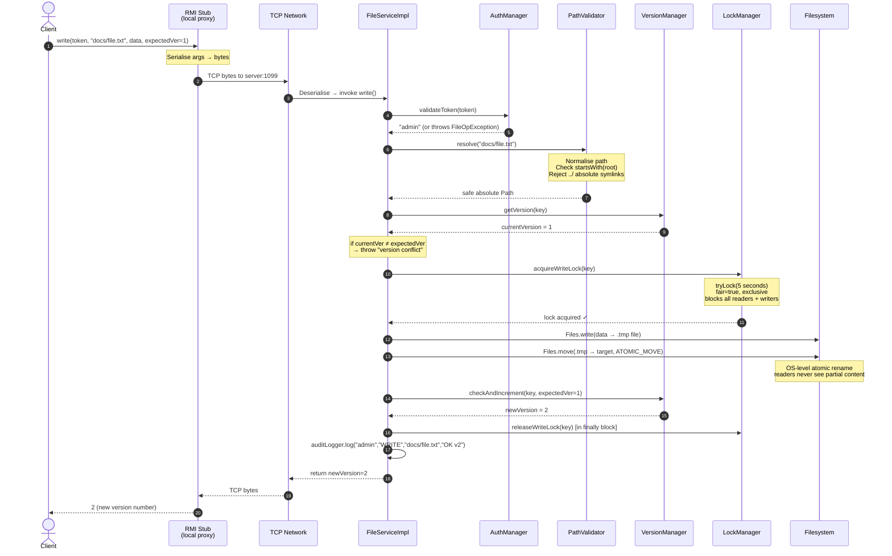

# RemoteFS — Remote File Management System

> A distributed file management system built with **Java RMI** for a
> Distributed Computing Systems lab. Supports concurrent multi-client
> operations with fair read-write locking, atomic writes, optimistic
> version control, and path-traversal protection.

---

## Table of Contents
1. [Project Structure](#project-structure)
2. [Prerequisites](#prerequisites)
3. [Build](#build)
4. [Running on the Same Machine](#running-on-the-same-machine)
5. [Running Across Two Machines (LAN)](#running-across-two-machines-lan)
6. [Client Command Reference](#client-command-reference)
7. [Default Users](#default-users)
8. [Sequence Diagram — `write()` call](#sequence-diagram--write-call)
9. [Locking Design](#locking-design)
10. [Security Design](#security-design)
11. [Running Tests](#running-tests)
12. [Audit Log](#audit-log)

---

## Project Structure

```
remotefs/
├── mvnw / mvnw.cmd          ← Maven Wrapper (no Maven installation needed)
├── pom.xml                  ← Parent POM (Java 17, JUnit 5)
├── common/                  ← Shared JAR: FileService, FileInfo, FileOpException
├── server/                  ← RMI server: ServerMain, FileServiceImpl, LockManager …
├── client/                  ← Console CLI: ClientMain, ConsoleCommands
├── tests/                   ← JUnit 5 integration & concurrency tests
├── server_data/             ← Created at runtime: files, audit.log, users.properties
└── README.md
```

| Module | Key Classes |
|--------|-------------|
| **common** | `FileService` (Remote interface), `FileInfo` (Serializable DTO), `FileOpException` |
| **server** | `ServerMain`, `FileServiceImpl`, `LockManager`, `VersionManager`, `AuthManager`, `PathValidator`, `AuditLogger` |
| **client** | `ClientMain` (REPL loop + RMI lookup), `ConsoleCommands` (CLI verbs) |
| **tests** | `ConcurrentAppendTest`, `AtomicReadWriteTest`, `VersionConflictTest`, `RenameDeadlockTest`, `PathTraversalTest`, `AuthSecurityTest` |

---

## Prerequisites

| Requirement | Version | Check |
|-------------|---------|-------|
| Java (JDK) | 17 or later | `java -version` |
| Maven | Not needed — use the included `mvnw.cmd` wrapper | — |
| Open port | 1099 (RMI registry) | — |

> **No Maven installation required.** The `mvnw.cmd` (Windows) / `mvnw` (Linux/macOS)
> wrapper downloads Maven automatically on first run.

---

## Build

```powershell
# From the remotefs/ directory — builds all four modules
.\mvnw.cmd compile          # Windows
./mvnw compile              # Linux / macOS
```

To build and run all tests:

```powershell
.\mvnw.cmd install
```

---

## Running on the Same Machine

Open **two separate terminal windows** in `c:\study_material\RemotFS\remotefs\`.

### Terminal 1 — Start the Server

```powershell
.\mvnw.cmd exec:java -pl server
```

Expected output:
```
==============================================
  RemoteFS Server starting
  RMI Registry port : 1099
  Storage root      : ...\server_data
  RMI hostname      : (auto-detect)
==============================================
[ServerMain] RMI registry created on port 1099
[AuthManager] Created default users.properties with test users:
  admin / admin123
  alice / password1
  bob   / password2
[ServerMain] FileService bound as 'FileService'
[ServerMain] Server is ready. Waiting for client connections...
```

> The server blocks indefinitely. Press **Ctrl+C** to shut down.

### Terminal 2 — Start the Client

```powershell
.\mvnw.cmd exec:java -pl client
```

Expected output:
```
✓ Connected to RemoteFS server
  Type 'help' for available commands, 'exit' to quit.

remotefs (not logged in)>
```

---

## Running Across Two Machines (LAN)

### Step 1 — Find the Server Machine's IP

On the **server machine** (Windows):
```powershell
ipconfig
# Look for: IPv4 Address . . . 192.168.x.x
```

On the **server machine** (Linux/macOS):
```bash
ip addr show   # or: ifconfig
```

### Step 2 — Start the Server with the Hostname Flag

This is critical — RMI embeds the hostname in the stub object that clients
receive. Without this flag, the stub contains `localhost` and remote clients
cannot connect.

```powershell
# Windows (replace with your actual IP)
.\mvnw.cmd exec:java -pl server -Djava.rmi.server.hostname=192.168.1.100

# Linux / macOS
./mvnw exec:java -pl server -Djava.rmi.server.hostname=192.168.1.100
```

### Step 3 — Firewall

Ensure **port 1099** is open on the server machine:

```powershell
# Windows — allow inbound on port 1099
New-NetFirewallRule -DisplayName "RMI Registry" -Direction Inbound `
    -Protocol TCP -LocalPort 1099 -Action Allow
```

> **Note:** Java RMI also uses a second random port for the actual method calls.
> For a lab, disabling the firewall entirely on the private network is simpler.

### Step 4 — Start the Client on the Remote Machine

Copy the built JARs to the client machine (or clone the repo and build there),
then:

```powershell
# Windows
.\mvnw.cmd exec:java -pl client -Dexec.args="--host 192.168.1.100 --port 1099"

# Linux / macOS
./mvnw exec:java -pl client -Dexec.args="--host 192.168.1.100 --port 1099"
```

Or using raw `java`:

```powershell
java -cp "common\target\classes;client\target\classes" `
     remotefs.client.ClientMain --host 192.168.1.100 --port 1099
```

---

## Client Command Reference

| Command | Syntax | Description |
|---------|--------|-------------|
| `login` | `login <user> <password>` | Authenticate; required before all other commands |
| `ls` | `ls [directory]` | List directory contents (omit path for root) |
| `cat` | `cat <path>` | Print file contents as UTF-8 text |
| `put` | `put <local-file> <remote-path>` | Upload a local file to the server |
| `get` | `get <remote-path> <local-file>` | Download a remote file to disk |
| `append` | `append <path> <text…>` | Append text (+ newline) to a file; creates it if missing |
| `rm` | `rm <path>` | Delete a file or an **empty** directory |
| `mv` | `mv <from> <to>` | Rename / move a file or directory |
| `mkdir` | `mkdir <path>` | Create a directory (parents created automatically) |
| `stat` | `stat <path>` | Show metadata: name, type, size, version, last modified |
| `help` | `help` | Print command list |
| `exit` | `exit` | Disconnect and quit |

### Quick Demo Session

```
login admin admin123
mkdir docs
put C:\myfile.txt docs/myfile.txt
ls docs
stat docs/myfile.txt
cat docs/myfile.txt
append docs/log.txt Server started at boot
append docs/log.txt Client connected
cat docs/log.txt
mv docs/myfile.txt docs/renamed.txt
get docs/renamed.txt C:\downloaded.txt
rm docs/renamed.txt
rm docs/log.txt
rm docs
exit
```

---

## Default Users

Created automatically in `server_data/users.properties` on first run.

| Username | Password |
|----------|----------|
| `admin` | `admin123` |
| `alice` | `password1` |
| `bob` | `password2` |

Passwords are stored as `saltHex:sha256Hex` — never in plaintext.

---

## Sequence Diagram — `write()` call

The following diagram shows the complete flow of a `write()` RMI call from
the client through every server component.



---

## Locking Design

### Why Locking?

Without locking, two clients writing simultaneously could interleave their
bytes — corrupting the file. Two clients performing `rename(A→B)` and
`rename(B→A)` simultaneously could deadlock forever.

### Data Structure

```
LockManager:
    ConcurrentHashMap<String, ReentrantReadWriteLock>
    key = normalised relative path  (e.g. "docs/file.txt")
```

`ConcurrentHashMap` is used because RMI spawns a new thread per client call.
Many threads can look up locks simultaneously without contention.

### Lock Types

| Operation | Lock type | Why |
|-----------|-----------|-----|
| `read()` | **Shared read lock** | Multiple readers allowed at once; only blocks if a writer holds the write lock |
| `write()`, `append()`, `delete()`, `rename()` | **Exclusive write lock** | Only one writer; blocks all readers and other writers |
| `list()`, `mkdir()`, `stat()` | **No lock** | Point-in-time metadata — same semantics as `ls` on a real OS |

### Fair Lock — Starvation Prevention

Every `ReentrantReadWriteLock` is created with **`fair = true`**:

```java
new ReentrantReadWriteLock(true /* fair */)
```

Without fairness: a steady stream of readers could keep the write lock
permanently unavailable — **writer starvation**. Fair mode serves threads in
FIFO (arrival) order, guaranteeing writers eventually get access.

### Timeout — No Infinite Blocking

Instead of `lock()` (blocks forever), we use:

```java
boolean acquired = lock.writeLock().tryLock(5, TimeUnit.SECONDS);
if (!acquired) throw new FileOpException("File is busy");
```

If a lock is held by another thread for more than 5 seconds (e.g. due to a
slow network write), the waiting thread gives up with a clean error message
instead of hanging the client forever.

### Atomic Writes — No Partial Content

```
write() flow:
  1. Write bytes → server_data/docs/.remotefs-XXXX.tmp  (temp file)
  2. Files.move(.tmp → target, ATOMIC_MOVE, REPLACE_EXISTING)
```

`ATOMIC_MOVE` is an OS-level directory-entry swap (a single `rename(2)` syscall
on Linux, `MoveFileExW` on Windows). At no moment does the target file contain
a mix of old and new bytes. Readers always see either the complete old content
or the complete new content.

### Deadlock Avoidance for Rename

`rename(from, to)` must hold write locks on **two** paths simultaneously.
If Thread 1 renames `A→B` (locks A, then B) while Thread 2 renames `B→A`
(locks B, then A), circular wait → deadlock.

**Solution — resource ordering:**

```java
// Always acquire locks in alphabetical order
if (path1.compareTo(path2) <= 0) {
    acquireWriteLock(path1);
    acquireWriteLock(path2);
} else {
    acquireWriteLock(path2);
    acquireWriteLock(path1);
}
```

Both threads always try to acquire the alphabetically-first lock first.
One wins, the other waits — no circular dependency, no deadlock.

### Version Control — Preventing Lost Updates

The classic "lost update" problem:
- Client A reads file at version 1
- Client B reads file at version 1
- Client B writes → version becomes 2
- Client A writes → **silently overwrites B's changes**

`write()` requires an `expectedVersion` parameter:

```java
// Client must first call stat() to get the current version
FileInfo info = service.stat(token, path);        // e.g. version = 1
int newVer = service.write(token, path, data, 1); // pass version back
```

If another client has written between the `stat()` and `write()` calls,
the version will have changed and the server throws:

```
FileOpException: Version conflict: expected version 1 but current version is 2.
                 Re-read the file and try again.
```

The check + increment happen **inside the write lock**, so there is no
TOCTOU (time-of-check to time-of-use) race condition.

---

## Security Design

| Threat | Mitigation | Code |
|--------|-----------|------|
| **Path traversal** (`../../etc/passwd`) | `PathValidator.resolve()` normalises path and checks `startsWith(storageRoot)` | `PathValidator.java` |
| **Symlink escape** | `toRealPath()` resolves symlinks; result must still be under root | `PathValidator.java` |
| **Plaintext passwords** | Salted SHA-256: stored as `saltHex:hashHex` in `users.properties` | `AuthManager.java` |
| **Rainbow table attack** | Random 16-byte salt per user — same password → different hash | `AuthManager.java` |
| **Timing attack** on login | `MessageDigest.isEqual()` constant-time comparison | `AuthManager.java` |
| **Unauthenticated access** | Every method (except `login`) calls `validateToken()` first | `FileServiceImpl.java` |
| **Session expiry** | Tokens expire after 30 min of inactivity | `AuthManager.java` |
| **Stack-trace leakage** | `FileOpException.fillInStackTrace()` returns empty trace | `FileOpException.java` |
| **Accountability** | All operations appended to `server_data/audit.log` | `AuditLogger.java` |

---

## Running Tests

```powershell
# Run all 25 JUnit 5 tests (no server needed — embedded RMI per test class)
.\mvnw.cmd test -pl tests

# Run a specific test class
.\mvnw.cmd test -pl tests -Dtest=ConcurrentAppendTest
```

| Test Class | Tests | Scenario |
|------------|:-----:|----------|
| `ConcurrentAppendTest` | 1 | 10 threads append to same file — all lines present, no corruption |
| `AtomicReadWriteTest` | 1 | Readers during write see only old **or** new content, never a mix |
| `VersionConflictTest` | 1 | Two writers with same `expectedVersion` — exactly one succeeds |
| `RenameDeadlockTest` | 2 | Cross-rename (`A↔B`) completes without deadlock within 10 s |
| `PathTraversalTest` | 12 | `../`, absolute, backslash paths all rejected; valid paths work |
| `AuthSecurityTest` | 8 | Invalid tokens, wrong passwords, user enumeration prevention |
| **Total** | **25** | **All passing ✓** |

---

## Audit Log

Every operation is appended to `server_data/audit.log`:

```
[2026-10-19T11:45:30.719] user=admin      op=LOGIN    path=-                    result=FAIL: Invalid username or password
[2026-10-19T11:45:30.733] user=admin      op=LOGIN    path=-                    result=OK
[2026-10-19T11:45:30.768] user=admin      op=WRITE    path=documents/pom.xml    result=OK (v1, 2640 bytes)
[2026-10-19T11:45:30.778] user=admin      op=READ     path=documents/pom.xml    result=OK (2640 bytes)
[2026-10-19T11:45:30.806] user=admin      op=RENAME   path=log.txt → renamed.txt result=OK
[2026-10-19T11:45:30.815] user=admin      op=DELETE   path=documents/renamed.txt result=OK
```

To watch the log live while operating:
```powershell
# In a third terminal:
Get-Content -Path "server_data\audit.log" -Wait
```
